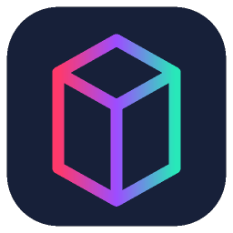
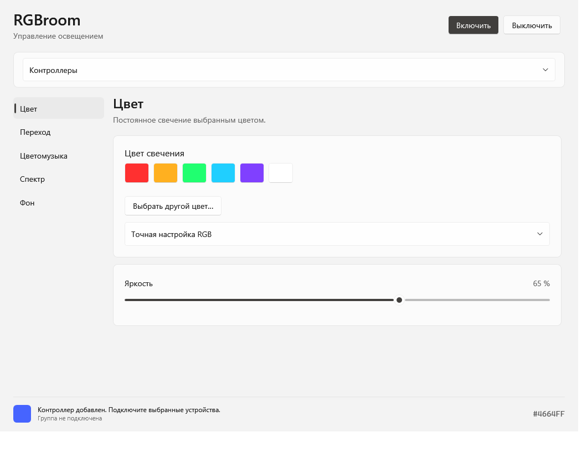

<div align="center">
  
  <h1>RGBroom</h1>
  <p><b>Цвет, музыка и свет вашего экрана — в одной комнате.</b></p>
  <p>Приложение для Windows и macOS: управление RGB-лентами по Wi-Fi и Bluetooth.</p>
  <p>
    
    
    
    
    
  </p>
  <p><a href="https://github.com/CrazyCorvis/RGBroom/releases/tag/v9.1.0">Скачать для Windows</a> · <a href="https://github.com/CrazyCorvis/RGBroom/releases/tag/v9.1.0-macos">Скачать для macOS</a> · <a href="Mac/README.md">Инструкция macOS</a> · <a href="COMPATIBILITY.md">Совместимость</a> · <a href="#сборка-из-исходников">Сборка</a></p>
</div>



## Свет под ваше настроение

Каждому режиму выделена своя вкладка с собственными настройками. Можно управлять несколькими контроллерами одновременно, в том числе с разными протоколами.

| Режим | Что делает |
| --- | --- |
| **Цвет** | Постоянный RGB-цвет, готовые оттенки и регулировка яркости. |
| **Переход** | Плавная смена цветов с настройкой скорости. |
| **Цветомузыка** | Четыре характера реакции: от плавного свечения до яркого разноцветного стробоскопа. |
| **Спектр** | Цвет определяется звуком: низкие частоты — красный, средние — синий, высокие — зелёный. Те же четыре характера реакции. |
| **Фон** | Подсветка повторяет основной цвет выбранного дисплея; доступны яркость и сглаживание. |

В музыкальных режимах можно выбрать выход звука и настроить чувствительность к низким, средним и высоким частотам. Стробоскоп включает цвет сразу на полной заданной яркости, без постепенного разгорания.

Соединения проверяются каждые 5 секунд. При потере связи приложение повторяет подключение с увеличением интервала до 15 секунд и восстанавливает актуальный цвет и состояние питания.

## Контроллеры

| Семейство | Подключение | Условия |
| --- | --- | --- |
| **Magic Home / LEDENET** | Wi-Fi, TCP | Поиск в локальной сети и ручной IP; несколько вариантов протокола. |
| **WLED** | Wi-Fi, HTTP JSON | Ручной IP; управление первым сегментом (`0`). |
| **Yeelight** | Wi-Fi, LAN + music mode | Нужны включённое LAN-управление и поддержка `set_music`; входящее соединение в локальной сети. |
| **Tuya / Smart Life** | Wi-Fi, LAN 3.3 / 3.4 / 3.5 | Нужны Device ID, local_key и совместимые точки данных (DP). Ключ вводится в приложении. |
| **ELK-BLEDOM / ELK-BLEDDM** | Bluetooth LE | Профиль GATT `FFF0 / FFF3`; встречается у контроллеров Lotus Lantern и duoCo Strip. |
| **Triones / LED BLE** | Bluetooth LE | Профиль GATT `FFD5 / FFD9`. |

**Название мобильного приложения не гарантирует совместимость.** Lotus Lantern и duoCo Strip используются разным оборудованием. ELK-BLEDOB, Tuya BLE Mesh и Zigbee-шлюзы этой версией не поддерживаются.

Новые адаптеры прошли программные проверки: сетевые эмуляторы, шифрованные сеансы Tuya и форматы BLE-пакетов. Проверка на реальных дополнительных контроллерах пока не выполнена. Подробности и ссылки на исследованные устройства — в [таблице совместимости](COMPATIBILITY.md).

## Подсветка компонентов ПК (OpenRGB)

Начиная с Windows 9.1.0 RGBroom управляет подсветкой совместимых материнских плат, RAM, видеокарт, вентиляторов и ARGB-зон через **OpenRGB SDK**. Это интеграция через отдельный OpenRGB, а не прямое подключение к фирменным SDK Asus, MSI, Gigabyte или ASRock.

1. Установите [OpenRGB](https://openrgb.org/) и проверьте, что он определяет вашу модель и позволяет менять её цвет. Сверьте [список поддерживаемого оборудования](https://openrgb.org/devices.html).
2. Закройте Aura Sync / Armoury Crate, Mystic Light / MSI Center, RGB Fusion и Polychrome, если они одновременно управляют тем же оборудованием.
3. В OpenRGB откройте **SDK Server** и нажмите **Start Server**. По умолчанию используются `127.0.0.1` и порт `6742`. Держите OpenRGB запущенным; открывать сервер в интернет не требуется.
4. В RGBroom раскройте **Контроллеры → Подсветка ПК**, нажмите **Найти компоненты**, отметьте компоненты целиком или отдельные зоны и добавьте их в группу.
5. Нажмите **Подключить выбранные** и выберите любой из пяти режимов RGBroom. Компоненты могут работать одновременно с Wi-Fi- и BLE-лентами.

Доступны устройства с режимом **Direct**. Число LED в ARGB-зонах предварительно задаётся в OpenRGB; RGBroom не меняет размеры зон, настройки аппаратуры и прошивки. Яркость задаётся цветом, выключение отправляет чёрный; команды не сохраняются во флеш-память. Обновления ограничены 30 кадрами/с на выбранную цель, фактическая скорость зависит от устройства. Выберите весь компонент либо его зоны, чтобы исключить двойное управление.

Проверка связи и переподключение действуют и для OpenRGB. При изменении списка компонентов RGBroom останавливает использование старых индексов и заново сопоставляет устройство по его имени, производителю, серийному номеру и расположению. При неоднозначном идентификаторе или изменении зон требуется повторный поиск.

Проверено на TCP-эмуляторе (SDK 3 с согласованием более нового сервера), включая изменение порядка устройств, зоны, яркость, выключение и переподключение. Физическая совместимость конкретных моделей Aura / Mystic Light / RGB Fusion / Polychrome пока не проверена.

## Быстрый старт

### Windows

1. Скачайте `RGBroom-Windows.zip` из [релиза для Windows](https://github.com/CrazyCorvis/RGBroom/releases/tag/v9.1.0).
2. Распакуйте архив целиком в постоянную папку.
3. Запустите `RGBroom.cmd` или `App\RGBroom.exe`.
4. Добавьте контроллеры, выберите нужные устройства и подключитесь.
5. Откройте вкладку режима и настройте подсветку.

Для ярлыка на рабочем столе запустите `CreateDesktopShortcut.cmd`. После перемещения папки создайте ярлык заново.

**Требования:** Windows 10 версии 2004 или новее / Windows 11, x64. Готовая сборка содержит .NET; отдельная установка среды не требуется. Для BLE нужен Bluetooth-адаптер с поддержкой Bluetooth Low Energy. Контроллеры Wi-Fi и ПК должны находиться в одной локальной сети без изоляции клиентов.

### macOS

1. Скачайте `RGBroom-macOS-arm64.zip` из [релиза для macOS](https://github.com/CrazyCorvis/RGBroom/releases/tag/v9.1.0-macos).
2. Распакуйте архив и перенесите `RGBroom.app` в **Программы**.
3. Откройте приложение, добавьте контроллеры и подключитесь.
4. Для Bluetooth, локальной сети, цветомузыки и фона предоставьте соответствующие разрешения по запросу macOS.

**Требования:** Mac с Apple Silicon (M1 и новее), macOS 14 или новее. .NET включён. Нативный интерфейс **SwiftUI** использует системное оформление macOS 27, боковую панель, Liquid Glass, светлую/тёмную тему и системные элементы управления; на более ранних системах — их стандартное оформление.

Звук и экран захватываются через ScreenCaptureKit, Bluetooth работает через CoreBluetooth, ключи Tuya хранятся в Keychain. Анализируется общий системный звук; BLE-устройства добавляются через поиск UUID этого Mac. Подробности и отличия: [**RGBroom для macOS**](Mac/README.md).

Сборка имеет локальную ad-hoc подпись, без Developer ID и нотарификации Apple. Если Gatekeeper блокирует первый запуск, проверьте источник загрузки и разрешите открытие в **Системные настройки → Конфиденциальность и безопасность → Всё равно открыть**. Глобально отключать защиту macOS не требуется.

## Локальная работа и настройки

Звук анализируется с выбранного выхода Windows, изображение — с выбранного дисплея. Приложение не сохраняет аудио и скриншоты при обычной работе и не отправляет их в облако.

Настройки находятся в `%LOCALAPPDATA%\RGBroom\settings.json`, журнал ошибок — в `errors.log` в той же папке. Tuya local_key защищается Windows DPAPI для текущего пользователя. Не публикуйте файл настроек и ключи устройства в issues.

## Сборка из исходников

Установите **.NET SDK 10** на Windows. Из корня репозитория выполните:

```powershell
powershell -NoProfile -ExecutionPolicy Bypass -File .\Source\build.ps1
```

Скрипт сначала собирает Debug и запускает функциональные и интерфейсные проверки. Только после их успешного завершения создаётся самостоятельная Release-сборка `App\RGBroom.exe`.

Для отладки без публикации:

```powershell
dotnet run --project .\Source\RGBroom.csproj -c Debug
```

Тестовые сценарии запускаются аргументами `--self-test` и `--ui-test`. Они не требуют контроллера; сетевые тесты используют локальные эмуляторы. Отчёт и снимок собственного интерфейса создаются сборочным скриптом в `Source\.build\`.

## Устройство проекта

Исходники C# и XAML находятся в `Source/`. `LightEngine.cs` объединяет режимы; `Effects.cs` обрабатывает спектр и цвет; `Capture.cs` получает звук и изображение. Адаптеры устройств находятся в `Network.cs`, `WifiConnections.cs`, `TuyaConnection.cs` и `BluetoothConnection.cs`. Сценарии проверок — `SelfTests.cs` и `AdapterTests.cs`.

`Mac/` содержит нативное macOS-приложение и платформенные адаптеры. Сетевые протоколы, модели и эффекты используются совместно с Windows без копирования исходников.

О том, как сообщить об устройстве или предложить изменение, — [CONTRIBUTING.md](CONTRIBUTING.md). Изменения версии — [CHANGELOG.md](CHANGELOG.md).

## Лицензия и благодарности

Исходники распространяются по **LGPL-3.0-or-later**: [LICENSE](LICENSE), [COPYING](COPYING). Метаданные моделей и реализация протокола Magic Home адаптированы из [flux_led](https://github.com/lightinglibs/flux_led). Захват звука использует [NAudio](https://github.com/naudio/NAudio). Атрибуция и лицензии зависимостей приведены в [THIRD-PARTY-NOTICES](Source/THIRD-PARTY-NOTICES.txt) и папке `Licenses/`.
